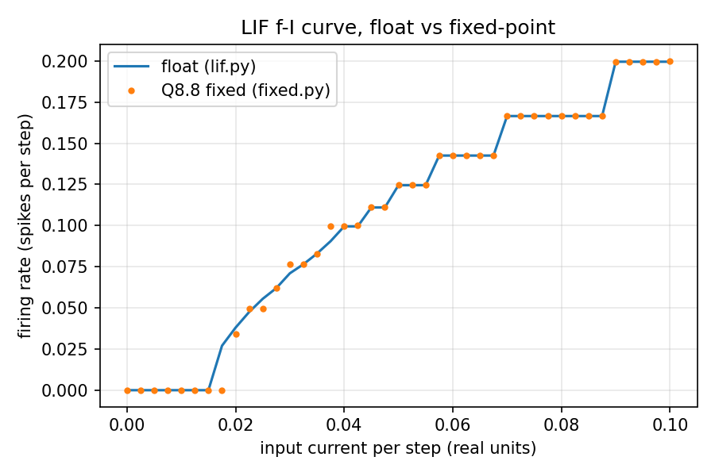
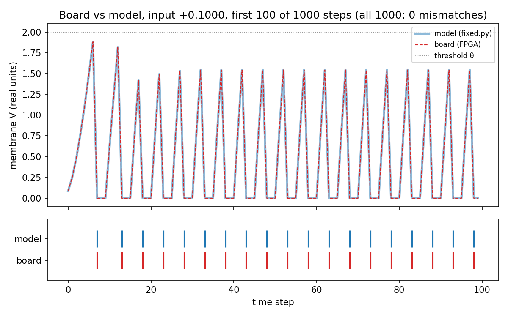
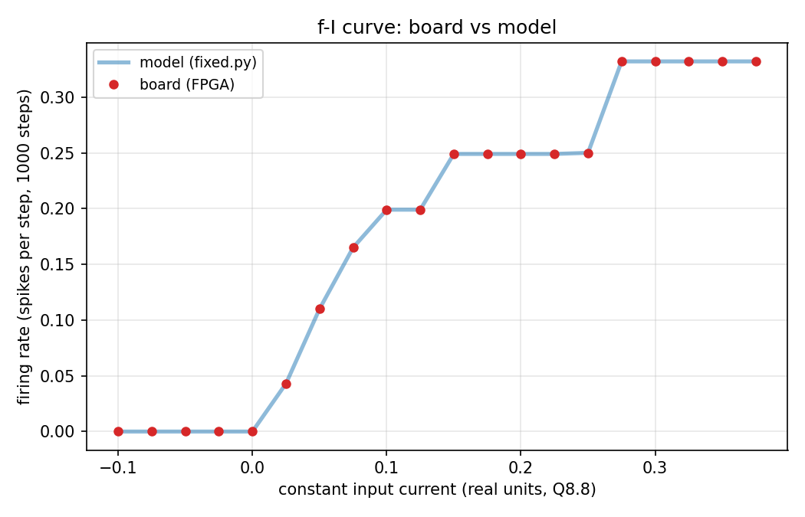
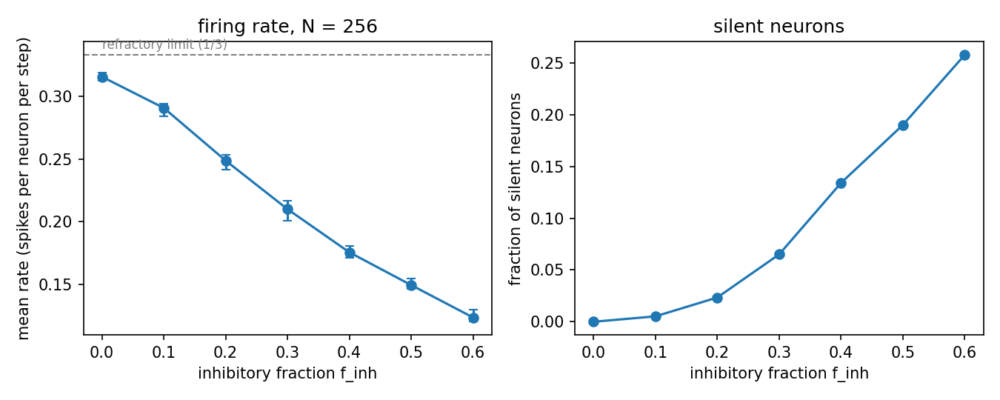

# neuro-fpga

A leaky integrate-and-fire (LIF) spiking neuron on a low-cost FPGA (Tang Nano 20K, Gowin GW2AR-18). The hardware is verified bit for bit against a Python reference model. The goal is a 256-neuron network for excitation/inhibition (E/I) perturbation experiments.

**Status (2026-11-04):** Milestones M1 (foundation) and M2 (single neuron on the board) are complete. The 256-neuron network (M3) is complete in simulation and on the board. The E/I perturbation experiment is complete in the model, and five of its conditions have been run on the board.

| Part | Status |
|---|---|
| Fixed-point LIF reference model, unit tests, f-I curve | done |
| LED, BSRAM self-test, UART echo on the board | done |
| Single LIF neuron RTL, bit-exact in simulation | done |
| PC–board command protocol, FPGA command decoder, status reply | done, on the board |
| Single neuron on the board vs model (M2) | done: 60,000 samples in three parameter sets, 0 mismatches |
| Full parameter sweep on the board | done: 2,248 sets, 0 mismatches (see [Parameter sweep](#parameter-sweep)) |
| 256-neuron network core, bit-exact in simulation (M3) | done for N = 16, 64, 256 (see [Network](#4-256-neuron-network-m3)) |
| Network with UART commands on the board | done: N = 256 command flow, 682 frames, 0 mismatches |
| E/I perturbation experiment | model sweep of 1,680 runs (10 networks per combination) done; 5 conditions on the board, 0 mismatches |

## 1. The neuron and its number format

### Model

The neuron is discrete in time. Each step updates a membrane potential `V` and a synaptic current `I`:

```
I[t+1] = I[t] - (I[t] >> k_s) + input
V[t+1] = V[t] + ((V_rest - V[t]) >> k_m) + I[t+1]
if V[t+1] >= theta:  spike = 1, V = V_reset, the neuron is refractory for `refrac` steps
```

- `>> k` is a division by 2^k, so the time constants are powers of two (`dt/tau = 2^-k`). No multiplier is needed.
- `refrac` is the refractory period in steps. While refractory, `V` is held at `V_reset` and `I` keeps integrating.
- Parameters: `theta`, `V_reset`, `V_rest`, `k_m` (0–15), `k_s` (0–15), `refrac` (0–7).

### Number format

All state is signed Q8.8 (16 bits, raw = real × 256). Every addition saturates to [−32768, 32767] after each addition, from left to right. Right shifts are arithmetic (floor toward −∞). The hardware uses 18-bit intermediates so that `-(I >> 0)` and `V_rest − V` cannot overflow. The rules are in [docs/DECISIONS.md](docs/DECISIONS.md) (D-001 to D-006).

### f-I curve



The float and fixed-point curves agree in shape. The largest difference is 0.027 spikes per step. The staircase comes from the refractory period and from the dead zone of the arithmetic shift.

## 2. Verification method

- **The model is the specification.** The RTL must match `model/fixed.py` bit for bit. A difference in one bit counts as a failure.
- **Simulation.** Icarus Verilog testbenches (`sim/tb_*.v`) and cocotb tests (`sim/test_*.py`). The expected values come from the Python model, not from the RTL.
- **Mutation testing.** Each checker was run against a deliberately broken copy of the RTL (for example `>>>` changed to `>>`, a checksum disabled, a record taken from the wrong step). Each broken copy was caught.
- **Board.** The same neuron runs on the FPGA. The host runs a fixed set of inputs, reads back `V` and `spike` for every step, and compares them with the model.

## 3. Board result (M2)

Three parameter sets, each with 20 constant input currents from −0.1 to 0.375 and 1000 steps per input. Every step's `V` and `spike` were compared with the model.

| Set | θ | V_rest | V_reset | k_m | k_s | refrac | What it tests | Mismatches |
|---|---|---|---|---|---|---|---|---|
| A | 2.0 | −0.25 | 0 | 4 | 3 | 2 | typical values, negative `V` | 0 / 20,000 |
| B | 0.5 | 0.25 | −0.5 | 0 | 0 | 0 | zero shifts, spiking every step above threshold | 0 / 20,000 |
| C | 2.0 | 0 | −0.5 | 15 | 15 | 7 | maximum shifts and refractory, saturation at −128.0 | 0 / 20,000 |





## Parameter sweep

`host/sweep.py` runs two sweeps on the board. Each parameter set is written to the board, confirmed by a status read, run with three constant inputs (−0.2, 0.1, 0.4) for 300 steps each, and compared step by step with the model.

| Sweep | Sets | What varies | Samples compared | Mismatches | Failed reads | Sets with spikes |
|---|---|---|---|---|---|---|
| Grid | 2,048 | every legal `k_m` (0–15), `k_s` (0–15), `refrac` (0–7); θ = 1.0, V_reset = −0.25, V_rest = 0.125 fixed | 1,843,200 | 0 | 0 | 2,024 |
| Random | 200 | θ, V_reset, V_rest, `k_m`, `k_s`, `refrac`, seed 20261103 | 180,000 | 0 | 0 | 195 |

In both sweeps the board's error counter did not change, so no request was refused. The 24 grid sets and 5 random sets without spikes are included on purpose: they check that silent neurons also match the model.

Raw results: `build/sweep_grid.csv` and `build/sweep_random.csv` (one row per set).

## 4. 256-neuron network (M3)

The network uses the same neuron as section 1. The only change is that the synaptic input `I` comes from the spikes of other neurons.

### Model

```
syn[i][t] = sat( Σ_j (W[j][i] << 2) · s[j][t−1]  +  ext[i] )
```

- `W` is a signed 8-bit weight matrix. `<< 2` is a global weight scale (`w_shift`, [D-009](docs/DECISIONS.md)).
- The sum over presynaptic spikes is exact in a wide register. The external input is added to that exact sum, and the total is saturated once. The order in which spikes arrive therefore does not change the result. This rule differs from section 1, which saturates after every addition ([D-008](docs/DECISIONS.md)).
- A spike at step `t` reaches the inputs at step `t+1` ([D-006](docs/DECISIONS.md)).

### Hardware

- Each memory has one write port and one synchronous read port. The synthesis tool maps such memories to block RAM. The same memories written as arrays become flip-flops, which at N = 256 needs about 45,000 cells, far more than the chip has.
- Synaptic input is event-driven. When neuron `j` spikes, its weight row is added to an accumulator for the next step. Two accumulators alternate: one is read while the other is written.
- Each step has two pipelined phases. Phase A updates every neuron. Phase B adds the weight rows of the spiking sources. The read order keeps consecutive reads on different neurons, so the pipeline never reads a value that is still being written ([`docs/EXPLAIN.md`](docs/EXPLAIN.md) 4.17).

### Board design

`rtl/network_top.v` adds four commands to the protocol from section 2. `RUN` already exists and is reused:

| Command | Code | Purpose |
|---|---|---|
| `WRITE_WEIGHTS` | 0x02 | Write part of the N × N weight matrix (up to 253 int8 values per frame) |
| `SET_INPUT` | 0x03 | Write part of the external input vector (up to 126 Q8.8 values per frame) |
| `RUN` | 0x04 | Run 1 to 1024 steps |
| `READ_COUNTS` | 0x07 | Spike count of each neuron (16 bits) |
| `READ_SNAPSHOT` | 0x08 | Membrane potential and spike of each neuron at the last step |
| `READ_TRACE` | 0x09 | Spikes of all neurons for 1 to 7 steps, from a given step (first 512 steps of a run) |

The board does not keep the membrane potential of every step. At N = 256 and 1024 steps, a full record would need about 4.4 Mbit, and the block RAM holds about 828 Kbit. Counts and the last-step snapshot need N × 33 bits, about 8.4 Kbit. The spikes are kept for every step, one bit per neuron, for the first 512 steps of a run. That takes 128 Kbit of block RAM, and `READ_TRACE` returns it 7 steps per frame. While a reply, a payload copy or a run is in progress, every command is refused and counted as an error. This includes `WRITE_PARAM`, so parameters cannot change in the middle of a run.

Resource use of the full design at N = 256 (nextpnr, GW2AR-18):

| Resource | Used | Available |
|---|---|---|
| LUT4 | 2,536 | 20,736 (12%) |
| Flip-flops | 1,315 | 15,552 (8%) |
| Block RAM | 45 | 46 (98%) |
| Maximum clock (after routing) | 38.75 MHz | 27 MHz target, met |

### Verification

| Check | Size | Result |
|---|---|---|
| Network core vs model (simulation) | N = 16, 64, 256 | 3,200, 12,800 and 51,200 records, all identical |
| Full design, byte level (simulation) | N = 16, 64, 256 | All replies identical. N = 256: 682 frames, 70,168 bytes in, 1,892 bytes out |
| Full design on the board | N = 256 | 682 frames, 1,892 reply bytes, all identical, PASS in 44.4 s (trace bitstream, fresh board, re-run 2026-11-06, log in `results/`) |
| Spike trace, simulation | N = 16 (T = 200 and 600), 64, 256 | All replies identical. Four mutants fail as they should |
| Busy refusal, simulation (`sim/tb_decoder_busy.v`) | every command while busy | PASS: 9 commands refused (no request, no state change), then accepted when idle |
| E/I conditions on the board, with trace | 5 conditions, N = 256 | 745 frames each, counts, snapshot and first 512 steps of spikes all identical, PASS |

The N = 256 command-flow test assumes a freshly loaded board, because its status replies count from power-up. Run after other tests without reloading, three status replies differ, and the counts, snapshot and trace still match.

Three deliberate faults in the full design (swapped input order, an off-by-one range check, and a wrong read-modify-write timing) each made the test fail.

Gate-level simulation of the synthesized netlist is not possible with the installed toolchain. The Gowin block-RAM models in the installed library are empty, so the simulation returns unknown values. Synthesis also reports 12 range warnings for the 8-bit weight memory. They come from padding bits of 1-bit-wide block-RAM slices and are not proven harmless by simulation. The board result is therefore the functional check ([D-012](docs/DECISIONS.md)).

### E/I perturbation experiment

Setup (model and board use the same network generator, `host/ei_full_sweep.py`):

- 256 neurons. Each neuron has about 8 random presynaptic partners (connection probability 8/N).
- A fraction `f_inh` of the neurons are inhibitory. Their outgoing weights are negative. Excitatory weights are random in [0, `w_max`]. Inhibitory weights are the same magnitude scaled by `w_inh`.
- External input per neuron is random in [0, `e_max`].
- θ = 1.5, V_rest = V_reset = 0, k_m = 4, k_s = 3, refractory period 2 steps.
- 600 steps; the first 100 are not counted.
- Chosen values: `w_max` = 10, `e_max` = 30, `w_inh` = 1.

Mean firing rate (spikes per neuron per step; the refractory limit is about 0.33), averaged over three random networks:

| f_inh | 0 | 0.1 | 0.2 | 0.3 | 0.4 | 0.5 | 0.6 |
|---|---|---|---|---|---|---|---|
| Rate | 0.316 | 0.291 | 0.249 | 0.210 | 0.175 | 0.149 | 0.123 |



- **Full sweep:** 1,680 runs covering `f_inh` 0 to 0.6, `w_inh` 0.5 to 2.0, `w_max` 10 and 20, and `e_max` 10, 30 and 60, with ten networks per combination. The mean rate falls as `f_inh` rises in all 24 combinations, and in every individual network.
- **Usable range:** at `w_max` = 10 and `e_max` = 30, most neurons sit near the refractory limit when `f_inh` is 0 (79% above rate 0.3). The informative range is `f_inh` 0.2 to 0.6.
- **Why `w_max` = 10:** with `w_max` = 60 the network is driven by its own recurrence. It is either silent or saturated, whatever the external input. The value `w_max` = 10 is a choice for this experiment, not a calibration to biology.
- **Board:** five conditions were run on the board, each with 745 frames. Every reply matched the full model, which is the reference here: the counts and last-step snapshot for all 256 neurons, and the spikes of the first 512 steps. The board-side rate printed by the script is over all 600 steps; the table above uses the mean after the first 100 steps, so the two differ slightly. The conditions were (`f_inh`, `w_inh`, `w_max`, `e_max`) = (0.2, 1.0, 10, 30), (0.5, 1.0, 10, 30), (0.5, 2.0, 10, 30), (0.5, 0.5, 10, 30) and (0.3, 1.5, 20, 10). The other sweep combinations exist only in the model.

## Repository layout

- `model/` — Python reference model. `fixed.py` is the bit-exact specification; `lif.py` is the float reference; `network.py` is the 256-neuron network; `fi_curve.py` draws the f-I figure.
- `rtl/` — Verilog. `lif_core.v` (one neuron step, combinational), `neuron_top.v` (single neuron on the board), `network.v` (network core), `network_top.v` (network on the board), `cmd_decoder.v` and `cmd_test.v` (command link), `uart_tx.v` / `uart_rx.v`, `uart_echo.v`, `bsram_test.v`, `blink.v`.
- `sim/` — testbenches (`tb_*.v`, including `tb_network.v` and `tb_network_top.v`), cocotb tests (`test_*.py`), and the generated test vectors (`*.mem`). One `Makefile` with the targets listed under "How to run".
- `fpga/` — `Makefile` (synthesis, place and route, pack, flash) and one `.cst` per top level.
- `host/` — PC side: `protocol.py` (frame format), `test_protocol.py`, `uart_loopback.py`, `board_cmd_test.py`, `run_trial.py` (M2 comparison), `sweep.py`, `plot_trial.py`, the network tests `board_network_test.py` (N = 256 command flow) and `ei_board_test.py` (E/I conditions on the board), the E/I model scripts `ei_sweep.py`, `ei_experiment.py`, `ei_full_sweep.py`, `ei_full_summary.py`, `plot_ei.py`, and the vector generators `gen_*.py`.
- `docs/` — `DECISIONS.md`, `LOG.md` (development log), `EXPLAIN.md` (theory and implementation notes), figures, and the paper notes in `docs/papers/`.

## How to run

Reference model:

```bash
cd model
python -m pytest
python fi_curve.py
```

Protocol tests (PC side). `host/pytest.ini` limits collection to `test_*.py`, so the board scripts are not imported:

```bash
cd host
python -m pytest
```

Simulation (Icarus Verilog, in WSL with the OSS CAD Suite). Targets are in `sim/Makefile`: `all`, `lif`, `uart`, `bsram`, `decoder`, `decoder_busy`, `cmd_test`, `neuron_top`, `uart_echo`, `network`, `network_top`:

```bash
cd sim
make lif                       # lif_core: 10,000 random + directed + multi-step
make uart                      # UART: cocotb tests
make network_top N=16 T=200    # full design, byte level (N defaults to 16, T to 200)
```

Board (WSL, with the board attached through usbipd):

```bash
source ~/oss-cad-suite/environment
cd fpga
make TOP=neuron_top            # synthesise, place and route, pack
make flash TOP=neuron_top      # load into SRAM (volatile)
cd ..
python3 host/run_trial.py /dev/ttyUSB1
```

Network on the board:

```bash
source ~/oss-cad-suite/environment
cd fpga
make TOP=network_top           # synthesise, place and route, pack
make flash TOP=network_top     # load into SRAM (volatile)
cd ..
python3 host/board_network_test.py /dev/ttyUSB1
python3 host/ei_board_test.py /dev/ttyUSB1 --f-inh 0.5 --w-inh 2.0
```

E/I model (no board needed; the full sweep takes about 4 minutes):

```bash
cd host
python3 ei_experiment.py       # writes build/ei_experiment.csv
python3 ei_full_sweep.py       # writes build/ei_full_sweep.csv (1,680 runs)
python3 ei_full_summary.py     # writes build/ei_full_summary.csv
```

The board forgets its bitstream and parameters at power-off.

## Limitations

- The board link has no hardware flow control. A single write of more than about 64 bytes can be lost in the USB–UART bridge, so the host paces longer transfers (see `host/uart_loopback.py`).
- The command decoder has no timeout. A corrupted length byte misaligns the next frame until the host resynchronises.
- Refused requests (a run or read sent while a reply is being sent) are counted as errors and not queued. The host must wait for each reply.
- The board is verified against the Python model, which implements the equations above. The model has not been compared with biological data.
- The sweep fixes θ, V_reset, and V_rest for the grid. Those three values are covered only by the random sweep.
- The network returns spike counts, the last-step snapshot, and the spikes of the first 512 steps of a run. It does not return the membrane potential of every step, so the step-by-step check on the board covers spikes only.
- In the network build, `READ_RECORD` has no reply, but the decoder still counts it as ok. The host must not send it. The ok and err counters are 8 bits and wrap at 255.
- The E/I results describe this model with the chosen `w_max`, `e_max`, and connection probability. They do not show anything about biological networks. The board runs cover five conditions in four of the 24 parameter groups; the rest of the sweep exists only in the model.
- The network netlist cannot be simulated with the installed toolchain (see section 4). The board result is the only functional check of the synthesized design.

## AI-assisted development

This project is developed with Claude Code. Design decisions, the verification method, and the accept/reject judgments are mine; see `docs/DECISIONS.md`. The decisions in `docs/DECISIONS.md` were reviewed by the author on 2026-11-06.

## License

Released under the MIT License. See [LICENSE](LICENSE).
